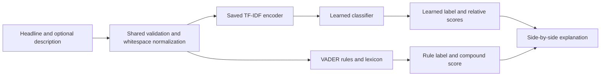
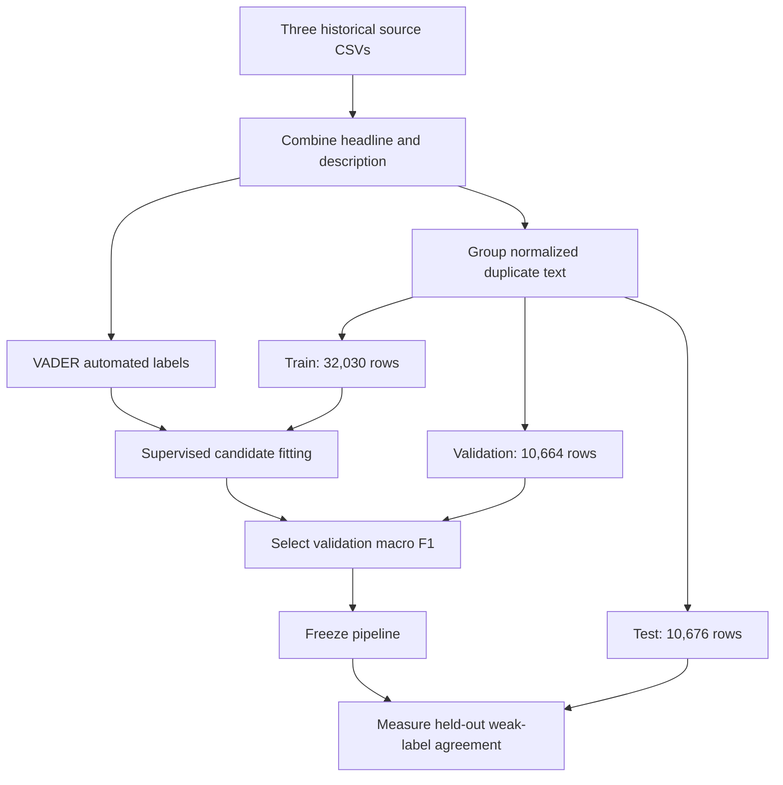
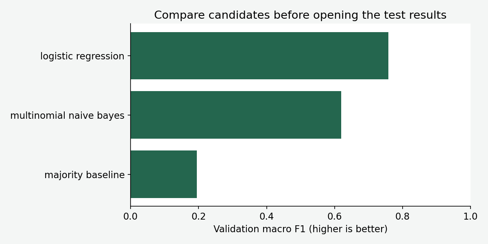
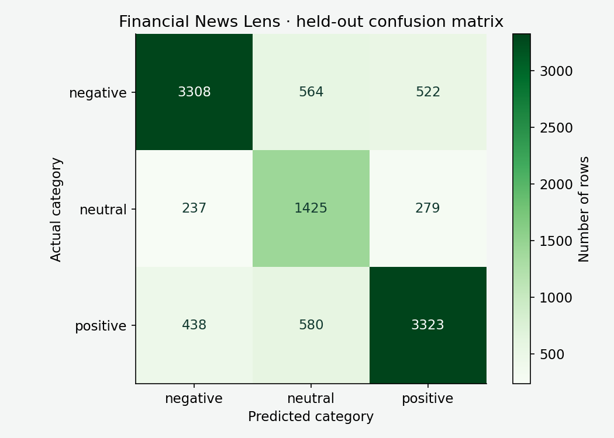
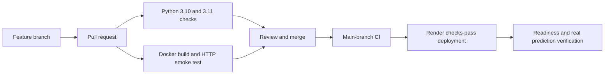

# Financial News Lens

**Live application:** [Open Financial News Sentiment](https://financial-news-sentiment-xr65.onrender.com) · [Source code](https://github.com/subhashdixit/financial-news-sentiment)

An end-to-end **weakly supervised text-classification learning app**, with a Flask interface, JSON API, CSV batch analysis, measured evaluation and CI/CD.

Paste a headline and optional description. Compare a learned TF-IDF classifier with the VADER rule-based system that supplied its training labels. The interface makes that distinction visible, rather than presenting automated-label agreement as human sentiment accuracy.

> This app does not predict stock prices, recommend trades or assess whether news is financially material. Scores are uncalibrated. Its test labels come from VADER, not independent human financial annotations. Use public or synthetic text.

[Run locally](#run-locally) · [Use the application](#use-the-application) · [Training](#training-from-source) · [Results](#measured-results) · [Deployment](#deployment-on-render)

## Problem statement and what we built

The original project explored sentiment in CNBC, Reuters and Guardian news snapshots. The new application turns that work into a reproducible text pipeline and a usable browser experience. It supports three source labels: **negative, neutral and positive**.

The learning objective is to understand text representation, automated labeling, multiclass classification, evaluation, serving and deployment. A model can imitate its labeling source without being a reliable financial analyst. For example, a sentence mentioning a loss might still describe an improvement if the loss narrowed; domain meaning can differ from a general sentiment lexicon.

Original notebooks, CSVs and saved `.sav` files remain preserved. [The original README](archive/original_README.md) records their earlier description. The new app does not deserialize those old models. It trains a fresh, versioned pipeline on a single combined headline/description input, rather than claiming to reproduce all original model variants unchanged.

## Architecture and the two meanings of prediction



VADER is a lexicon/rule system: it combines word sentiment and context rules, including emphasis and negation. The classifier learns patterns in text that correlate with VADER-produced labels. They are different mechanisms, but the learned model's evaluation target is still VADER's output.

A `PredictionService` class holds the loaded pipeline, metrics and VADER analyzer. Shared functions normalize inputs and apply weak-label boundaries. Flask handles HTTP and renders HTML. Training is separate; a visitor's request never triggers fitting or downloading a language resource.

## Run locally

Use Python 3.10 or 3.11 and the pinned package versions.

```bash
git clone https://github.com/subhashdixit/financial-news-sentiment.git
cd financial-news-sentiment
python3 -m venv .venv
source .venv/bin/activate
python -m pip install --upgrade pip
pip install -r requirements-dev.txt
pip install --no-deps -e .
python -m pip check
flask --app wsgi:app run --host 127.0.0.1 --port 8000
```

On Windows, activate with `.venv\Scripts\Activate.ps1`. Use the Flask development server locally, and Docker for a matching Linux production runtime if needed. Open [http://127.0.0.1:8000](http://127.0.0.1:8000).

The reviewed model is included. `vaderSentiment` includes its lexicon, so this app does not depend on a runtime `nltk.download()` call. Keep scikit-learn 1.6.1 when loading the saved pipeline.

For production-style local serving on Linux/macOS:

```bash
gunicorn --config gunicorn.conf.py wsgi:app
python scripts/smoke_test.py --url http://127.0.0.1:8000 --attempts 3
```

`PORT` controls the listening port. `MODEL_DIR` can point to another trusted matching pipeline/report/sample directory. Run commands from the repository root.

## Use the application

1. Enter a headline and an optional description. The initial example is synthetic, not an actual report.
2. Select **Analyze sentiment**. Read the learned label and the three relative class scores.
3. Compare the VADER label and compound score below it. Disagreement is informative: it shows the learned model does not exactly reproduce the labeling rules.
4. Inspect the unknown-vocabulary warning if there are no recognized TF-IDF terms. A model can still produce an intercept-driven label for unknown text; that result is unreliable.
5. Download the sample CSV, retain `headline` and optional `description` columns, add rows and upload it. Batch output contains generated labels and scores, not the original text.
6. Read the model card and confusion matrix, keeping in mind that the reference labels are automated.

Limits: 200 records, 5,000 combined characters per record and 1 MiB per request. Headline must be a nonempty string; description must be a string when present. Whitespace is normalized. Extra columns are ignored. The app does not write submitted text to storage; hosting infrastructure may still record routine request metadata.

## API: commands and responses

| Route | Purpose |
|---|---|
| `GET /` | Browser interface |
| `POST /predict` | HTML form |
| `POST /api/predict` | JSON object containing a `records` list |
| `GET /sample.csv` | Synthetic input example |
| `POST /predict-csv` | Multipart CSV upload in the `file` field |
| `GET /api/metrics` | Source hashes, splits, model version and evaluation |
| `GET /health/ready` | Readiness and deployed Git revision |

```bash
python -c 'import json; from pathlib import Path; x=json.loads(Path("models/sample.json").read_text()); Path("request.json").write_text(json.dumps({"records":[x]}))'
curl -X POST http://127.0.0.1:8000/api/predict \
  -H 'Content-Type: application/json' --data-binary @request.json
curl http://127.0.0.1:8000/sample.csv -o sample.csv
curl -X POST http://127.0.0.1:8000/predict-csv \
  -F 'file=@sample.csv' -o sentiment.csv
```

Each prediction includes `label`, relative class `scores`, `vader_label`, `vader_compound`, `matched_terms` and an optional warning. `matched_terms` counts recognized analyzer terms, including repeated terms and bigrams; it is not the count of unique financial concepts. The response explicitly identifies its evaluation target as automated VADER labels and includes model version.

Malformed inputs return 400, oversized bodies 413, unknown routes 404 and unexpected failures 500 with a generic client message. HTML output escapes submitted text. Generated CSV output avoids echoing untrusted strings into spreadsheet formulas. Public-demo request bounds do not replace authentication or per-user rate limiting for a production service.

## Data and weak-label construction

| Source file | Original rows | Available text |
|---|---:|---|
| `cnbc_headlines.csv` | 3,080 | Headline and description |
| `guardian_headlines.csv` | 17,800 | Headline |
| `reuters_headlines.csv` | 32,770 | Headline and description |

These are historical snapshots, including 2020-era examples, rather than a current news feed. The combined source has 53,650 rows; after removing empty/oversized combined text, the training pipeline retains **53,370 rows**. No dates are inferred as current market information.

For every retained row, headline and optional description are combined and whitespace normalized. `vaderSentiment==3.3.2` assigns a compound score:

| Compound score | Weak label |
|---|---|
| At least +0.05 | positive |
| At most −0.05 | negative |
| Between those boundaries | neutral |

These are VADER's conventional boundaries. They are not independently annotated financial labels. Reusing the same rules to label train and test means a high test score demonstrates generalization of **rule imitation** across held-out text, not validation against human judgment. VADER itself can produce labels directly without training; the learned model is an educational comparison, not a necessary replacement.

The original repository retains source CSVs and publisher text. Collection/redistribution rights are not independently established here. Verify source terms before redistributing or using the material commercially. The serving image excludes raw news CSVs and contains only reviewed artifacts and application code.

## Training from source

```bash
python scripts/train.py
python scripts/plot_results.py
# Keep a candidate separate from the reviewed serving model:
python scripts/train.py --output-dir /tmp/news-candidate
```



Text is grouped by a lowercase normalization that collapses non-word sequences. Identical normalized texts stay together. GroupShuffleSplit uses seeds 42 and 43. This is a grouped random split, not a chronological, publisher-separated or event-separated test: paraphrases and reports about the same event can appear across partitions.

TF-IDF is fitted on training only. It uses up to 20,000 features, unigrams and bigrams, minimum document frequency 2 and sublinear term frequency. The pipeline retains stop words rather than deliberately removing negation words such as “not.” Tokenization still has limitations with financial symbols, abbreviations and unusual spelling.

### TF-IDF in plain language

Think of a document as a weighted shopping basket of words. A frequent word in one document receives weight, but a word appearing in almost every document is less distinctive. IDF emphasizes terms that distinguish documents. Bigrams add short phrases, such as “not good,” alongside single words.

TF-IDF does not understand events, accounting rules or time. It creates a sparse numeric representation. Unseen words contribute nothing to that representation, so we explicitly warn when no vocabulary terms match.

| Candidate | Mechanism | Advantage | Limitation |
|---|---|---|---|
| Majority baseline | Always predict the common training label | Shows performance without meaningful text modeling | Ignores all text |
| Multinomial Naive Bayes | Combine class-conditional weighted term evidence | Fast, small and strong as a basic text baseline | Conditional-independence assumption is simplistic; scores are often poorly calibrated |
| Balanced logistic regression | Learn regularized weighted term contributions to class scores | Good sparse-text baseline; compact and efficient | Limited context/word-order understanding and no financial reasoning |

Naive Bayes uses smoothing alpha 0.5. Logistic regression uses balanced class weights and up to 1,000 iterations. Validation macro F1 selects the winner; test data does not choose the model. Candidates are fixed rather than an exhaustive hyperparameter search.

## Measured results

| Validation candidate | Agreement with VADER | Macro F1 |
|---|---:|---:|
| majority baseline | 41.14% | 0.194 |
| multinomial naive bayes | 68.47% | 0.620 |
| logistic regression | 77.49% | 0.758 |



Selected model: **logistic regression**. On **10,676 held-out rows**, agreement with VADER is **75.46%** and macro F1 is **0.736**. Do not restate this as “75% accurate financial sentiment” or stock-direction accuracy.

| VADER reference class | Precision | Recall | F1 | Support |
|---|---:|---:|---:|---:|
| negative | 0.831 | 0.753 | 0.790 | 4,394 |
| neutral | 0.555 | 0.734 | 0.632 | 1,941 |
| positive | 0.806 | 0.765 | 0.785 | 4,341 |



Rows are VADER reference labels and columns are learned predictions. For neutral text, precision is about 0.555: many learned neutral predictions differ from the rule label. That weakness matters even though the overall agreement appears respectable.

**Accuracy/agreement** is matching labels divided by all rows. It is easy to explain but depends on class prevalence and label quality. **Precision** asks how often predictions of one class match the reference; **recall** asks how many reference examples of that class are recovered. **F1** combines them using `2PR/(P+R)`. **Macro F1** gives all three classes equal weight, reducing domination by common labels; it does not account for the business cost of each error.

For negative text, recall is `3308/4394 = 0.753`. The model retrieves about three quarters of the VADER-negative examples. That does not prove those examples were financially negative to an expert.

### What is still unknown

No independent human-annotated financial test set, financial-domain calibration, future-event validation, multilingual evaluation, sarcasm benchmark or market-impact study is included. General sentiment words can conflict with accounting meaning. A company result can be positive relative to expectations while still containing negative vocabulary. Do not translate a sentiment label into an investment action.

## Testing and code quality

```bash
python -m black --check src tests scripts wsgi.py gunicorn.conf.py
python -m pylint src scripts wsgi.py gunicorn.conf.py
python -m pytest -q
python -m pip check
```

Tests exercise real saved-model inference, single/batch parity, API/form/CSV consistency, text normalization, malformed records, weak-label boundaries, unknown vocabulary, HTML escaping, model hash mismatch, upload limits, security headers, readiness, metric totals and HTTP errors.

A checksum detects accidental artifact mismatch, not malicious changes to both the model and report. Joblib models must come from a trusted reviewed source because loading pickle-based formats can execute code. Never deserialize user-uploaded artifacts.

Browser checks complement unit tests: the page must render, the example form must produce a result, the matrix must be readable and the mobile layout must remain usable. Passing lint does not prove that the ML assumptions are correct; evaluation and data audits are separate work.

## CI/CD: what happens after a change



**CI**, continuous integration, checks whether changes remain compatible. The workflow installs pinned dependencies, checks formatting and Pylint, runs tests and builds a Docker image. Its container job starts the image and sends a real HTTP prediction. This catches missing files and packaging mistakes that an in-process test alone can miss.

**CD**, continuous deployment, publishes an accepted revision to hosting. Render must be configured to deploy **after CI checks pass**, matching `render.yaml`. Merely committing that YAML does not activate a service; the hosting service has to be connected or created from the blueprint.

Benefits include repeatability, early error detection and traceable releases. Costs include build time, dependency maintenance and platform configuration. Passing tests does not guarantee good predictions, so model evaluation and release review remain necessary. The included CI does not automatically retrain or promote new models.

## Docker: what it adds

Docker packages the Python runtime, application, dependencies and reviewed model into an image. A running container is an instance of that image. It helps a developer and CI use a similar environment, even when the developer's laptop runs a different operating system.

```bash
docker build -t financial-news:local .
docker run --rm -p 8000:8000 --read-only --tmpfs /tmp financial-news:local
python scripts/smoke_test.py --url http://127.0.0.1:8000 --attempts 3
```

The container runs as a non-root user and excludes source news CSVs from the image. It contains the saved pipeline, not a training job. `--read-only` prevents application writes except under the temporary directory.

Docker improves packaging consistency but adds image size, build time and another layer to maintain. It is not a virtual machine, automatic security guarantee or mandatory requirement for Flask. This project uses **native Python on Render** to demonstrate deployment without Docker; its Dockerfile provides a portable alternative and CI packaging check.

## Deployment on Render

**Hosting** provides the computer and public endpoint where an app runs. **Deployment** installs a particular application version into that environment. Render is the hosting platform; GitHub stores the source; GitHub Actions runs quality checks; Gunicorn serves Flask requests.

Create a free **Web Service** connected to this repository and `main`, or use the supplied blueprint. Required settings:

| Setting | Value |
|---|---|
| Runtime | Python |
| Plan | Free |
| Build command | `pip install -r requirements.txt && pip install --no-deps .` |
| Start command | `gunicorn --config gunicorn.conf.py wsgi:app` |
| Health check | `/health/ready` |
| Auto deploy | After CI checks pass |
| Python | 3.11.11 |
| `OPENBLAS_NUM_THREADS`, `OMP_NUM_THREADS` | `1` |

Render supplies `PORT`. Gunicorn binds to `0.0.0.0:$PORT` with one worker and two threads. The small worker count avoids loading several independent copies of the model on a small instance. Heavy training runs outside the web process.

After deployment, verify readiness and an actual prediction:

```bash
python scripts/smoke_test.py --url https://YOUR-SERVICE.onrender.com \
  --expected-revision YOUR_DEPLOYED_GIT_SHA --attempts 12
```

A service being marked live only proves that it started. The prediction check verifies that the model, sample, routes and deployed source revision work together. Check the form in a browser as well.

Render's free services sleep after 15 idle minutes and can take about a minute to wake. Free web services share 750 running hours per workspace per calendar month; other portfolio apps consume the same allowance. Local files are ephemeral. Bandwidth and build limits are separate. This application uses no database and stores no user uploads. A free demo is not an always-on production availability promise. See [Render free-service documentation](https://render.com/docs/free).

## Versioning, retraining and rollback

There are several separate versions:

- **Git commit:** identifies code, configuration and committed artifacts.
- **Model version:** `1.0.0` in the report identifies the reviewed model release.
- **Dependency versions:** pinned Python libraries define the compatible runtime.
- **Data hashes:** identify the exact workbook bytes used in training.

Retraining changes learned parameters. Deployment changes the serving release. You can deploy a documentation fix without retraining, and you can train a candidate without deploying it.

For a model update, train into a candidate directory, compare validation behavior and limitations, run compatibility tests, update the model/report/sample as one unit, review the change and deploy. Keep the previous artifact available. If the test set guides repeated tuning, it is no longer untouched; reserve a fresh evaluation period or external set before making stronger claims.

For rollback, prefer reverting the problematic merge through a reviewed Git commit and allowing CI/CD to publish the restored code **and matching model/report**. Render also offers rollback to a limited number of previous deploys on its free plan. A manual hosting rollback does not revert GitHub; reconcile the source branch so the next deployment does not reintroduce the problem. See [Render deploy documentation](https://render.com/docs/deploys).

Rollback improves recovery time but cannot undo already consumed outputs, and model/schema changes can break compatibility. That is why the artifact hash, feature contract, version and smoke checks travel together.

## Repository structure

```text
src/news_sentiment/       shared text contract, service, Flask routes, HTML/CSS
scripts/train.py         weak-label creation, grouped split and model selection
scripts/plot_results.py  charts generated from recorded metrics
scripts/smoke_test.py    deployed readiness and real HTTP inference check
tests/                   input, weak-label, vocabulary, API, CSV and artifact tests
models/                  reviewed pipeline, metrics and synthetic sample
docs/images/             measured evaluation figures
archive/                 original README
*.csv, *.ipynb, *.sav     preserved original source material
render.yaml              native Python/Gunicorn deployment configuration
Dockerfile               portable alternative and CI packaging check
.github/workflows/       Python checks and real container smoke test
```

## Troubleshooting and monitoring

Run from the repository root. If imports fail, activate the virtual environment and install the package. If model hashes disagree, restore matching trusted artifacts. Keep pinned scikit-learn when loading the pipeline. A no-vocabulary warning means the learned result is driven mainly by model intercepts rather than recognizable text.

Check readiness, a real prediction and hosting errors separately. A healthy server can still produce poor domain predictions. The app has no live news collection, feedback labeling, drift alerting or automatic retraining. If extending it, collect authorized human annotations and assess publisher/time/event separation before making stronger claims. Avoid storing submitted text in logs.

## Further reading

- [VADER original project, rules and conventional boundaries](https://github.com/cjhutto/vaderSentiment)
- [Scikit-learn text feature extraction](https://scikit-learn.org/stable/modules/feature_extraction.html#text-feature-extraction)
- [Scikit-learn leakage and preprocessing](https://scikit-learn.org/stable/common_pitfalls.html)
- [Classification metrics](https://scikit-learn.org/stable/modules/model_evaluation.html)
- [Flask deployment on Render](https://render.com/docs/deploy-flask)

VADER is MIT-licensed; publisher articles and existing source datasets have separate rights. Repository code licensing does not confer ownership of third-party text.
